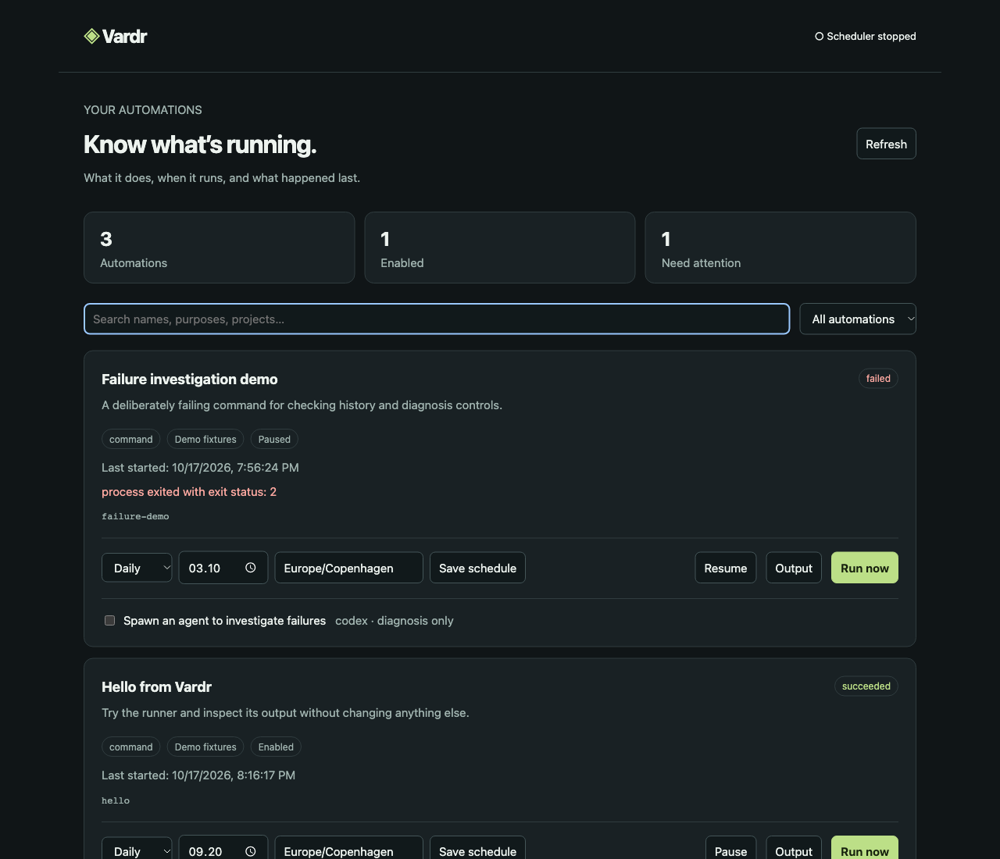

# Vardr

Know what your automations do, why they exist, when they run, and what happened last.

Vardr is a lightweight Rust CLI and background runner with an optional local browser dashboard. Agents use the CLI; humans can use either. Closing the dashboard does not stop automations. MIT licensed.

**First draft, v0.1.0.** macOS and Linux. No Electron runtime, Node runtime, database server, or always-open browser is needed. Agent processes run only when a task or failure investigation calls for them. Actual agent memory use depends on the chosen agent.



## What works

- Required names and purpose descriptions, project/machine labels, and a working directory for each automation.
- Manual, interval, and daily schedules with IANA timezones and optional weekdays. Pause, resume, reschedule, and run now through the CLI or dashboard.
- Ordinary commands, Codex CLI, Claude Code, and T3 Code launches. Existing Codex/T3 schedules remain independent; Vardr does not modify their scheduler files.
- Durable run records, bounded streaming logs, timeouts that terminate process groups, per-job overlap prevention, and configurable scheduler concurrency (one by default).
- Optional **spawn an agent to investigate failures**, with a separate result/log and a per-job cooldown. Investigations diagnose; they do not automatically repair or retry jobs. The original failure stays a failure.
- Read-only launchd inventory. Discovery does not adopt, alter, or disable existing services.
- Signed GitHub Release updates using the same standalone-helper pattern as [Ratatoskr Skill Sync](https://github.com/oana-ffg/ratatoskr-skill-sync). Automatic checks run once per local day, from midnight by default, when the scheduler has no workers active.

## Try it

Build with Rust 1.90 or newer:

```sh
cargo build --release --locked
./target/release/vardr init
./target/release/vardr put examples/hello.json
./target/release/vardr run hello
./target/release/vardr ui
```

The example is paused and manual. It only prints a greeting. `run` explicitly runs even a paused job. Open the private loopback URL printed by `ui`; it grants access to that dashboard session. Start the scheduler independently with `vardr serve`; the UI itself does not schedule work.

For an isolated trial, pass an absolute `--home` directory on every command or set `VARDR_HOME`. The default is the platform's local application-data directory, printed by `init` and `status`. Job definitions and logs stay in that private directory, outside this repository.

To install the binary from source:

```sh
cargo install --path . --locked
vardr service plan
vardr service install
```

`service install` is macOS-only and installs one per-user LaunchAgent. It runs after login; it does not wake a sleeping Mac or run before the user logs in. On Linux, run `vardr serve` under your existing supervisor. `service remove` removes only the recorded, unchanged Vardr service. No service is installed by building, `init`, or opening the dashboard.

## CLI for agents

```sh
vardr list --json
vardr show hello
vardr schedule hello --daily 09:00 --timezone Europe/Copenhagen
vardr schedule hello --every 3600
vardr pause hello
vardr resume hello
vardr history hello
vardr logs hello
vardr logs hello --investigation
vardr status --json
vardr discover --json
vardr update
```

Create jobs with `put FILE.json`. To edit a job, fetch it with `show`, edit the returned JSON, and submit it with `put`. The saved `revision` prevents silently overwriting another CLI/UI edit. The dashboard uses the same Rust storage and runner code. Schedule changes retain your other fields. An edit establishes a new scheduling baseline; it does not replay earlier occurrences.

Configure an investigator in the job definition, then toggle it with:

```sh
vardr investigate hello --enabled true
vardr investigate hello --enabled false
```

See [verification and current limits](docs/verification.md), [job definitions and agent targets](docs/jobs.md), [execution semantics](docs/execution.md), and [signed release operations](docs/releases.md).

## Updates

The official verification key and release endpoint are compiled into the binary. No signing-key setup is needed on users' machines. Automatic updates are enabled by default when `serve` runs. Edit the local `config.json` to change the time or disable them:

```json
{
  "max_concurrency": 1,
  "retained_runs": 30,
  "log_limit_bytes": 1048576,
  "updates": { "automatic": true, "time": "00:00" }
}
```

The scheduler checks at most once per day at or after that local time, verifies the update's signature and executable version, atomically replaces the binary, and restarts when its own workers are idle. Update failures are saved in `updates.json` and exposed by `status`; they do not stop task dispatch. `update --install` is available with the scheduler stopped. No release published yet is treated as no available update.

## Scope

This first version manages one installation at a time. Machine labels describe local jobs; they are not remote-routing instructions. Central multi-machine views, importing/adopting existing launchd definitions, external notifications, event/webhook triggers, dependency graphs, and monitoring a dispatched T3 run to completion are future work. There is no speculative trigger engine running in the background.

T3 launches are recorded as **dispatched**, not succeeded. The receipt links to the actual T3 thread; its execution and approvals remain owned by T3. A failed dispatch can trigger investigation, but a later failure inside T3 currently cannot. T3 integrations support environment or gopass credential references and need an authorized reachable MCP endpoint; a temporary per-turn token is not a permanent scheduler credential.

## Development

```sh
cargo fmt --all --check
cargo clippy --all-targets --locked -- -D warnings
cargo test --locked
```

CI runs on Apple Silicon macOS, Intel macOS, and Linux x64. Release signing is build-time tooling only; production requires just the native binary. The optional UI binds only to IPv4 loopback and authenticates its page with a private entry URL and protects its API with a fresh per-process token. No telemetry or hosted service.
