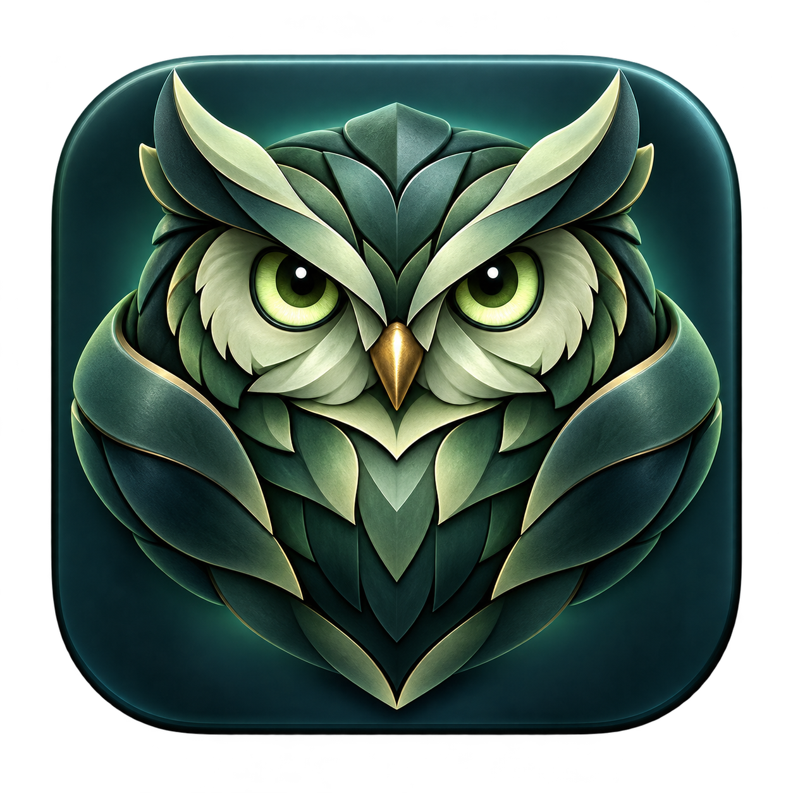

# Vardr application icon

Generated with the built-in image_gen tool. This is the original full-resolution application icon artwork. Packaging runs `scripts/prepare-desktop-icons.py` to produce the PNG and ICNS resources from this source, preserving transparency. The generated `assets/vardr.png` is embedded in the CLI for the authenticated dashboard header and favicon; `desktop/shell/vardr.png` supplies the native startup screen. All three views use the same artwork. To rebuild them manually, run `python3 scripts/prepare-desktop-icons.py` from the repository root.

## Generation prompt

Use case: logo-brand.
Asset type: a polished production macOS application icon, one single square icon for Vardr, a lightweight automation guardian app.

Primary request: create an exceptionally attractive, distinctive watchful guardian owl emblem with a subtle Nordic character. A calm, clever owl face formed from a few bold sculpted feather shapes, with upright ear tufts and luminous pale-lime eyes. Its layered wings/brow form a compact, almost diamond-shaped silhouette, echoing a watchful protective shield. A tiny warm brass beak gives a restrained warm accent. Friendly and capable, not angry or childish.

Style: premium tactile 3D app icon, sculpted jade-green ceramic and satin dark metal, elegant rounded forms, crisp deliberate geometry, soft studio highlights, gentle dimensional depth. Sophisticated and beautifully finished, with simple broad shapes rather than fine feather detail. Front-facing, centered, no perspective tilt.

Palette: rich forest and sage greens, pale pistachio highlights, deep midnight petrol/teal, tiny muted gold accent. Strong separation of the owl from its backdrop.

Composition: the owl fills most of a midnight-teal rounded-square macOS icon tile. Comfortable consistent outer padding and softly rounded corners, subtle internal lighting and depth, very restrained shadow. A clean silhouette readable in the Dock at 32–64 pixels. The rounded tile itself must have crisp finished edges; the area OUTSIDE the tile must be genuinely transparent.

Constraints: one finished icon, no presentation board, no multiple variants, no desktop mockup, no writing or letters, no watermark, no clock numerals, no tiny gears, no decorative runes, no extra objects, no busy scenery. Transparent background outside the rounded icon tile.
